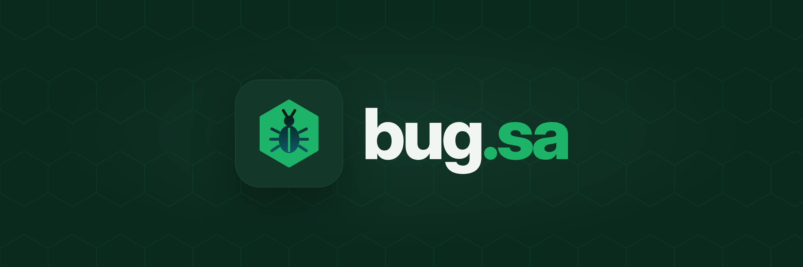

  

  <a href="README.md">English</a> · <b>العربية</b>

# bug.sa

منصة المكافآت الأمنية في المملكة العربية السعودية، للجهات والباحثين الأمنيين. **قريبًا.**

## ما نبنيه

- **برامج مكافآت الثغرات:** برامج عامة أو خاصة أو بالدعوة فقط، بنطاقك وقواعدك ونطاقات المكافآت التي تحددها.
- **الفرز والتحقق:** يُعاد إنتاج كل بلاغ وتُزال التكرارات ويُصنَّف حسب الخطورة قبل أن يصل إلى فريقك.
- **مكافآت الباحثين:** تُصرف المكافآت للباحثين بالريال السعودي، مع سجل المدفوعات في مكان واحد.
- **اختبار الاختراق:** اختبارات محددة المدة ينفذها باحثون موثوقون للإطلاقات والتدقيق والامتثال.
- **تسجيل CVE:** يطلب الباحثون معرّف CVE، فنراجع الطلب وننشره في قائمة CVE العالمية مع أسمائهم في الشكر.
- **النشرات الأمنية:** تشترك الجهات بتقنياتها وإصداراتها، وتُنبَّه عندما تتأثر بثغرة.

## جرّبها الآن

[حاسبة CVSS](https://bug.sa/ar/cvss) تحسب درجات متجهات CVSS 3.1 و4.0 وتقارن بينها جنبًا إلى جنب، بالعربية والإنجليزية.

## تواصل معنا

[contact@bug.sa](mailto:contact@bug.sa)

